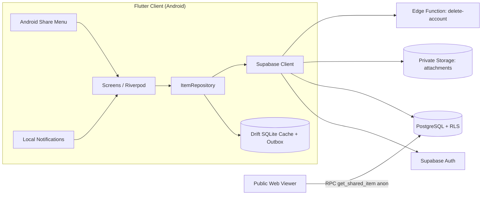

# Stashly 2.0

> *"I found something useful and don't want to lose it."*

Stashly is a private, cross-device save-for-later application for notes, links, snippets, and images. Built with **Flutter (Dart)** and **Supabase** (Auth, Postgres + RLS, Private Storage, Edge Functions).

**Scope Delivered:** All Stages (Stage 1 to 3) and Advanced Missions (**Missions A, B, C, D, and E**).

---

## 1. Scope & Stages Reached

| Stage / Mission | Status | Deliverables |
|---|---|---|
| **Stage 1: Local Inbox** | Completed | SQLite (Drift) cache, CRUD, full-text live search, tag filtering, swipe archive/restore, delete confirmation, empty states |
| **Stage 2: Cloud + Auth** | Completed | Email/password Supabase auth, RLS-backed remote sync (`SyncedItemRepository`), auto-wipe local cache on signout |
| **Stage 3 Core: Share-In** | Completed | Android `ACTION_SEND` intent filters (`text/plain`, `image/*`), parser handling Chrome `Title\nURL` formats, pre-filled editor |
| **Mission A: Better Sync** | Completed | Offline-first outbox worker with exponential backoff (2s, 5s, 15s, 60s, 5m), debounced draft autosaving, optimistic concurrency locking |
| **Mission B: Public Links** | Completed | Unguessable 48-char hex tokens in `share_links`, secure `get_shared_item` RPC, create/revoke controls, static web viewer (`public_viewer/index.html`) |
| **Mission C: Attachment Vault** | Completed | Private bucket storage (`<uid>/<item_id>/<file>`), 10MB limit & MIME validation, 60-min signed URLs, cleanup on item delete |
| **Mission D: Resurface Later** | Completed | Inexact local notifications (`flutter_local_notifications` + `timezone`), quick pickers (Tomorrow 9am, 7 days 9am, custom), tap payload routing to item |
| **Mission E: Data Ownership** | Completed | Full JSON export via `share_plus`, typed "DELETE" account deletion calling Deno Edge Function (`delete-account`) to wipe auth, files, rows, and local cache |
| **Biometric App Lock** | Completed | Fingerprint / Face ID lock screen (`local_auth` + `USE_BIOMETRIC`), lock screen guard, and settings toggle |

---

## 2. Architecture & Data Flow



### Key Technical Decisions
- **Repository Pattern:** `ItemRepository` acts as an abstract contract with `SyncedItemRepository` handling write-through caching, outbox queueing, and optimistic concurrency. UI widgets talk exclusively to Riverpod providers.
- **Offline First:** All create/edit/archive actions apply immediately to the local Drift database (`isDirty: true`), providing instantaneous UI responsiveness without waiting for network calls.
- **Client-Side UUIDs:** IDs are generated client-side using `Uuid().v4()`, allowing new items to be created and linked offline prior to syncing.

---

## 3. Security & Privacy Guarantees

1. **Database Row Level Security (RLS):**
   - RLS is enabled on all tables (`public.saved_items`, `public.share_links`).
   - Policies strictly enforce `owner_id = (select auth.uid())` for SELECT, INSERT, UPDATE, and DELETE.
   - Unauthenticated `anon` queries to `saved_items` return empty sets (`[]`).
2. **Private Storage Protection:**
   - The `attachments` bucket is strictly **private**.
   - Storage RLS requires paths to start with `(storage.foldername(name))[1] = auth.uid()`. User B cannot fetch or download User A's attachments even if the exact path is known.
   - Attachments are displayed via short-lived signed URLs (60 minutes).
3. **Cross-Account Cache Isolation:**
   - On sign-out or account switch, `LocalItemRepository.wipeLocalData()` completely clears the local SQLite database so User A's data is never visible to User B.
4. **Public Link Unguessability:**
   - Tokens are 48-hex character cryptographic strings generated server-side via `extensions.gen_random_bytes(24)`.
   - The `get_shared_item(p_token)` RPC is marked `security definer` and only returns display fields (title, content, url, tags, updated_at). **Attachments, internal item IDs, and owner UUIDs are never exposed**.
   - The public viewer uses `textContent` rendering only, completely eliminating XSS vulnerabilities.

---

## 4. Conflict Resolution Policy (Mission A)

Stashly follows an offline-first **optimistic concurrency** policy:
- **Rule:** *Most recently updated wins, with interactive warning.*
- **Concurrency Check:** Updates send the server timestamp last seen by the client:
  ```dart
  final rows = await supabase
      .from('saved_items')
      .update(patch)
      .eq('id', id)
      .eq('updated_at', baseUpdatedAt)
      .select();
  ```
- **Conflict Handling:** If the row was updated elsewhere, zero rows match. The user is prompted with three options:
  1. **Keep Mine (Overwrite):** Force updates the remote record with local changes.
  2. **Use Theirs:** Discards local changes and reloads the remote version.
  3. **Save Mine as a Copy:** Creates a duplicate item locally so no data is lost.
- **Draft Preservation:** Local drafts in SQLite survive app kills and background sync refreshes.

---

## 5. Account Deletion & Data Ownership (Mission E)

- **JSON Data Export:** Exports all user notes, links, snippets, tags, timestamps, and attachment metadata into a single `.json` file and triggers the Android share sheet.
- **Account Deletion:**
  - Requires typing `"DELETE"` in the confirmation dialog.
  - Invokes the `delete-account` Supabase Edge Function using the user's JWT.
  - The Edge Function removes all storage objects under `<user_id>/` and deletes the auth user via Admin API, triggering `on delete cascade` on all database records (`saved_items`, `share_links`).
  - Clears the device's local SQLite database and redirects to the sign-in screen.

---

## 6. Known Limitations

- **Local Reminders:** Reminders are scheduled locally on the device via `flutter_local_notifications` and do not sync across devices as remote push notifications.
- **Public Links:** Public share links expose text and URL fields only; attachments are excluded from public shares for privacy.
- **Platform Focus:** Targeted for **Android** (iOS share extension and APNS are not configured).

---

## 7. How to Run Locally

### Prerequisites
- Flutter SDK (stable)
- Android Studio or Android device/emulator

### Running the Flutter Client
```powershell
flutter pub get
flutter run --dart-define=SUPABASE_URL=https://iodqhxejlviovoaivnke.supabase.co --dart-define=SUPABASE_ANON_KEY=sb_publishable_Y4JMsINnkWaE9JLIi9vqQw_q_ON8E36
```

### Running Unit Tests
```powershell
flutter test
```

### Supabase Migrations
The database migrations and edge functions are located in `supabase/`:
- `supabase/migrations/20261012000001_create_saved_items.sql`
- `supabase/migrations/20261012000002_create_attachments_storage.sql`
- `supabase/migrations/20261012000003_create_share_links.sql`
- `supabase/functions/delete-account/index.ts`