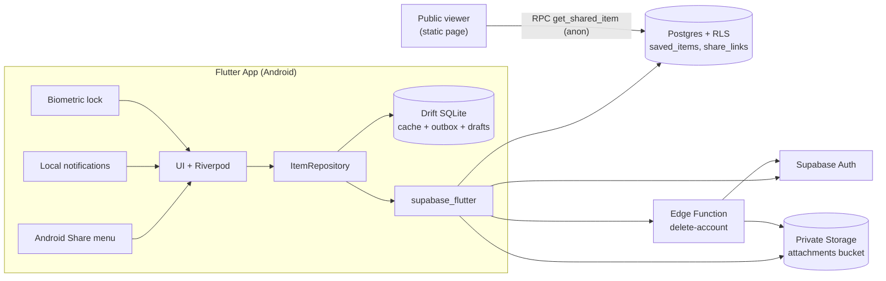

# Stashly 2.0

> "I found something useful and don't want to lose it."

Stashly 2.0 is a private, cross-device save-for-later app for notes, links, snippets and images. It works offline, syncs to the cloud, and keeps every user's data isolated at the database level.

**Stack:** Flutter (Dart) · Supabase (Auth, Postgres + RLS, Private Storage, Edge Functions) · Drift (SQLite) · Riverpod  
**Download:** [Latest APK](https://github.com/codewithrim/stashly-2.0/releases/latest)

---

## What I Built

| Stage / Mission | Highlights |
|---|---|
| **Stage 1: Local inbox** | Create, view, edit, delete, archive/restore notes, links and images; tags; live search and tag filtering; swipe actions; empty states; data persists across restarts (Drift/SQLite) |
| **Stage 2: Cloud + auth** | Email/password sign-up and sign-in; items stored remotely with an owner ID; RLS-enforced privacy; loading, error and retry handling |
| **Stage 3: Share into app** | Android Share menu accepts text and URLs (`text/plain`, `image/*`); handles Chrome's `Title\nURL` format; opens a pre-filled editor; malformed input never crashes |
| **A: Better sync** | Offline-first outbox with exponential backoff, local cache, debounced draft autosave, optimistic concurrency with a conflict dialog |
| **B: Public links** | Revocable read-only link per item using a random 48-char token; static web viewer |
| **C: Attachment vault** | Images and PDFs in a private bucket, 10 MB limit, MIME validation, signed URLs, cleanup on delete |
| **D: Resurface later** | Local reminders (tomorrow, in 7 days, custom); tapping opens the item; handles deleted items |
| **E: Data ownership** | JSON export; account deletion that removes auth user, rows, files and local cache |
| **Bonus: App lock** | Optional fingerprint/face lock (`local_auth`) with a settings toggle |

---

## Architecture



- **Stage 1:** Mobile App → Local Storage (Drift)
- **Stage 2:** Mobile App → Authentication → Backend / Database
- **Stage 3:** Adds Storage, Edge Function, public viewer, Share intent and notifications, as shown above.

---

## Authentication, Storage and Data Protection

- **How authentication works:** Users sign up and sign in with email and password through Supabase Auth. The session (JWT) is stored by `supabase_flutter` and attached to every request. The app routes unauthenticated users to the sign-in screen.
- **Where data is stored:**
  - **On device:** A Drift/SQLite cache of items, a write outbox and drafts, so the app works offline.
  - **In Supabase:** Items in Postgres (`saved_items`, `share_links`), files in a private Storage bucket (`attachments`).
- **How one user is protected from another:** Protection is enforced by the backend, not the UI:
  - **Row Level Security** is enabled on all tables. Every policy requires `owner_id = (select auth.uid())` for select, insert, update and delete, so requesting another user's item ID returns nothing. Anonymous requests also return nothing.
  - **Storage policies** require the first path segment to equal the caller's user ID (`<uid>/<item_id>/<file>`). Files are served through 60-minute signed URLs, and knowing a path is not enough.
  - **Public links** use a random server-generated token (24 random bytes, 48 hex chars). A security definer RPC returns only title, content, URL, tags and update time. Owner IDs, item IDs, other items and attachments are never exposed. Revoked or deleted links show an "unavailable" page.
  - **Cache isolation:** The local database is wiped on sign-out and account switch.
  - **Secrets:** Only the publishable anon key is used in the app. The service-role key exists only as a server-side secret in the Edge Function.

---

## Key Technical Decisions

- **Repository pattern:** UI talks only to Riverpod providers over an abstract `ItemRepository`. `SyncedItemRepository` handles write-through caching, the outbox and concurrency.
- **Offline-first:** Writes hit local SQLite first (`isDirty: true`) for instant UI, then sync in the background.
- **Client-generated UUIDs (v4):** Items can be created offline before they reach the server.
- **Conflict policy:** Most recently updated wins, with a warning. Updates send the last-seen `updated_at`; if the row changed elsewhere, zero rows match and the user chooses Keep mine, Use theirs, or Save mine as a copy. Drafts are never discarded during a refresh.
- **Edge Function for account deletion:** Deleting an auth user needs admin privileges that must never live in the client. The function verifies the caller's JWT, removes their files, then deletes the user; `on delete cascade` removes all rows.
- **Static public viewer:** Supabase Edge Functions can't serve HTML on the default domain, so a small static page calls the RPC and renders with `textContent` only (no XSS).

---

## Getting Started

### Prerequisites
Flutter SDK (stable), Android Studio or an Android device/emulator, and a Supabase project.

```bash
# 1. Install dependencies
flutter pub get

# 2. Run (replace with your own project values)
flutter run \
  --dart-define=SUPABASE_URL=https://<your-project>.supabase.co \
  --dart-define=SUPABASE_ANON_KEY=<your-publishable-key>

# 3. Run tests
flutter test
```

### Backend setup (Supabase CLI)
```bash
supabase link --project-ref <your-project-ref>
supabase db push
supabase functions deploy delete-account
```

- **Migrations** live in `supabase/migrations/`: `create_saved_items` · `create_attachments_storage` · `create_share_links`
- **Public viewer:** Host `public_viewer/index.html` on any static host (GitHub Pages, Netlify) after setting your project URL and anon key inside it.
- **Release build:** `flutter build apk --release --dart-define=...` → `build/app/outputs/flutter-apk/app-release.apk`

---

## Known Issues and Limitations

- Reminders are local to each device. They are not synced as push notifications.
- Public links share text fields only. Attachments are excluded for privacy.
- Conflicts are resolved by choice, not merged. There is no field-level merge.
- Android only. The iOS share extension and APNs are not configured.
- After account deletion, all items, files and public links are removed immediately; provider-side backups may persist briefly under Supabase's retention policy.

---

## Project Structure

```
lib/
  core/         # config, router, errors, validators
  data/         # models, Drift DB, repositories, services
  features/     # auth, inbox, editor, detail, share_in, settings
supabase/
  migrations/   # SQL schema, RLS, storage policies
  functions/    # delete-account (Edge Function)
public_viewer/  # static page for public links
```
