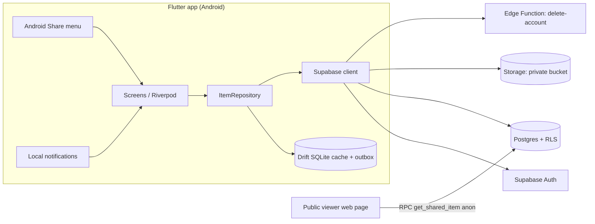

# Stashly

> "I found something useful and don't want to lose it."

Stashly is a private, cross-device save-for-later app for notes, links, snippets and images.
Built with **Flutter (Dart)** and **Supabase** (Auth, Postgres + RLS, Storage, Edge Functions).

**Target scope: every stage and every advanced mission in the brief.**

| Stage | Scope |
|---|---|
| 1 | Local inbox: CRUD, tags, search/filter, archive/restore, local persistence |
| 2 | Email + password auth, remote storage, RLS privacy, error/retry handling |
| 3 core | Share-into-app (text + URLs, Android Share menu) |
| 3 A | Better sync: retry, cache, draft preservation, remote-edit detection, documented conflict policy |
| 3 B | Public read-only link per item, revocable, unguessable token |
| 3 C | Attachment vault (images + PDFs) with storage-level ownership |
| 3 D | Resurface later: local notification reminders, tap opens item, deleted-item handling |
| 3 E | Data ownership: JSON export + full account deletion (rows + files) |

---

## 0. Instructions for the AI agent (read first)

1. Work **one phase at a time** (section 9). Finish a phase, run its acceptance checklist, then commit. Do not start the next phase until the current one runs on a device/emulator.
2. **Commit after every meaningful step** with Conventional Commit messages (`feat:`, `fix:`, `docs:`, `chore:`). The repo history is part of the submission.
3. A reliable smaller app beats a broken bigger one. If a phase is unstable, fix it before adding features.
4. **Security rules are non-negotiable:**
   - Privacy is enforced by Postgres RLS and Storage policies, never by client-side filtering.
   - The Supabase **service-role key must never appear in the Flutter app or the repo**. Only the anon (publishable) key ships in the client.
   - Every RPC/Edge Function that bypasses RLS must be reviewed for ownership checks.
5. Keep code explainable: small files, clear names, comments on non-obvious decisions. The author must be able to explain every part.
6. Before adding a package, check the latest version and API on pub.dev (`flutter pub add <pkg>`); package APIs change.
7. Target **Android first**. iOS is out of scope unless time remains.
8. Do not invent features outside this document without asking.

---

## 1. Tech stack

| Concern | Choice |
|---|---|
| Language/framework | Flutter (stable), Dart |
| State management | `flutter_riverpod` |
| Navigation | `go_router` (supports deep links, e.g. notification -> item) |
| Local DB / cache | `drift` + `drift_flutter` (SQLite) |
| Backend | Supabase via `supabase_flutter` |
| Auth | Supabase Auth, email + password |
| Files | Supabase Storage (private bucket) |
| Server logic | Supabase Edge Functions (Deno/TypeScript) for account deletion only |
| Share-in | `receive_sharing_intent` (or `share_handler`; pick whichever is maintained) |
| Reminders | `flutter_local_notifications` + `timezone` + `flutter_timezone` |
| Misc | `uuid`, `image_picker`, `file_picker`, `url_launcher`, `share_plus`, `path_provider`, `connectivity_plus`, `intl` |
| Migrations | Supabase CLI (`supabase/migrations/*.sql`) |

---

## 2. Architecture



**Layers**

- `ItemRepository` is an abstract interface. Implementations:
  - `LocalItemRepository` (Stage 1, Drift only).
  - `SyncedItemRepository` (Stage 2+): reads from the Drift cache, writes through to Supabase, queues failed writes in an outbox, and refreshes the cache from remote.
- UI only talks to providers that wrap the repository. No Supabase calls from widgets.

**Suggested structure**

```
lib/
  main.dart
  app.dart                      # MaterialApp.router, theme
  core/
    config.dart                 # SUPABASE_URL / ANON_KEY via --dart-define
    router.dart
    errors.dart                 # AppException types + user-friendly messages
    validators.dart             # title/url/tag rules
  data/
    models/item.dart
    local/db.dart               # Drift tables: items, outbox, drafts
    repositories/
      item_repository.dart
      local_item_repository.dart
      synced_item_repository.dart
    services/
      attachment_service.dart
      reminder_service.dart
      share_link_service.dart
      export_service.dart
      account_service.dart
  features/
    auth/        # sign in, sign up
    inbox/       # list, search, filter chips, archive tab
    editor/      # create/edit, draft autosave
    detail/      # view, open link, attachment preview
    share_in/    # incoming share handling
    settings/    # export, delete account, sign out
supabase/
  migrations/
  functions/delete-account/index.ts
public_viewer/index.html        # static page for public links
```

---

## 3. Data model

Table: `public.saved_items`

| Column | Type | Notes |
|---|---|---|
| `id` | uuid PK | Client-generated UUID v4 (enables offline create) |
| `owner_id` | uuid | FK `auth.users`, defaults to `auth.uid()` |
| `type` | text | `note` / `link` / `image` |
| `title` | text | max 200 chars |
| `content` | text | note body / snippet, max 20,000 chars |
| `url` | text | http(s) only, max 2048 chars |
| `tags` | text[] | max 20 tags |
| `archived` | boolean | default false |
| `remind_at` | timestamptz | nullable (Mission D) |
| `attachment_path` | text | Storage path, nullable (Mission C) |
| `attachment_name` / `attachment_mime` | text | nullable |
| `created_at` / `updated_at` | timestamptz | `updated_at` maintained by trigger |

Dart model mirrors this with `fromJson` / `toJson` / `copyWith`. Local Drift `items` table mirrors it plus `dirty` and `deleted_locally` flags for the outbox.

### Input rules (validators.dart)

- Title: trimmed; if empty, auto-fill from URL host, first line of content, or "Untitled". Max 200.
- URL: trim, add `https://` if no scheme, parse with `Uri.tryParse`, **allow only http/https** (reject `javascript:`, `file:`, etc.), max 2048.
- Tags: trim, lowercase, strip leading `#`, dedupe, max 30 chars each, max 20 per item.
- Content: max 20,000 chars. Whitespace-only counts as empty.
- A note needs title or content. A link needs a valid URL. An image needs an attachment.
- Never crash on null/odd input: every parse is guarded and surfaces a friendly message.

---

## 4. Supabase backend

Put each block below in `supabase/migrations/` as ordered files.

### 4.1 Tables, constraints, trigger

```sql
create extension if not exists pgcrypto with schema extensions;

create table public.saved_items (
  id uuid primary key default gen_random_uuid(),
  owner_id uuid not null default auth.uid() references auth.users(id) on delete cascade,
  type text not null check (type in ('note','link','image')),
  title text not null default '' check (char_length(title) <= 200),
  content text check (content is null or char_length(content) <= 20000),
  url text check (url is null or (char_length(url) <= 2048 and url ~* '^https?://')),
  tags text[] not null default '{}' check (cardinality(tags) <= 20),
  archived boolean not null default false,
  remind_at timestamptz,
  attachment_path text,
  attachment_name text,
  attachment_mime text,
  created_at timestamptz not null default now(),
  updated_at timestamptz not null default now(),
  -- attachment must live in the owner's own folder
  constraint attachment_in_owner_folder
    check (attachment_path is null or attachment_path like owner_id::text || '/%')
);

create index saved_items_owner_updated_idx on public.saved_items (owner_id, updated_at desc);
create index saved_items_tags_idx on public.saved_items using gin (tags);

create function public.set_updated_at()
returns trigger language plpgsql set search_path = '' as $$
begin
  new.updated_at = now();
  return new;
end $$;

create trigger saved_items_set_updated_at
  before update on public.saved_items
  for each row execute function public.set_updated_at();
```

### 4.2 Row Level Security

```sql
alter table public.saved_items enable row level security;

create policy "select own" on public.saved_items
  for select to authenticated using (owner_id = (select auth.uid()));

create policy "insert own" on public.saved_items
  for insert to authenticated with check (owner_id = (select auth.uid()));

create policy "update own" on public.saved_items
  for update to authenticated
  using (owner_id = (select auth.uid()))
  with check (owner_id = (select auth.uid()));

create policy "delete own" on public.saved_items
  for delete to authenticated using (owner_id = (select auth.uid()));
```

No policy exists for `anon`, so unauthenticated requests see nothing.

### 4.3 Storage (Mission C)

```sql
insert into storage.buckets (id, name, public, file_size_limit, allowed_mime_types)
values ('attachments', 'attachments', false, 10485760,
        array['image/jpeg','image/png','image/webp','application/pdf'])
on conflict (id) do nothing;

-- Path convention: <user_id>/<item_id>/<filename>
create policy "attachments select own" on storage.objects
  for select to authenticated
  using (bucket_id = 'attachments' and (storage.foldername(name))[1] = (select auth.uid())::text);

create policy "attachments insert own" on storage.objects
  for insert to authenticated
  with check (bucket_id = 'attachments' and (storage.foldername(name))[1] = (select auth.uid())::text);

create policy "attachments update own" on storage.objects
  for update to authenticated
  using (bucket_id = 'attachments' and (storage.foldername(name))[1] = (select auth.uid())::text);

create policy "attachments delete own" on storage.objects
  for delete to authenticated
  using (bucket_id = 'attachments' and (storage.foldername(name))[1] = (select auth.uid())::text);
```

The bucket is **private**. The app displays files through short-lived signed URLs (`createSignedUrl`, 60 minutes). Obscure filenames are not the security mechanism; the policies are.

### 4.4 Public read-only sharing (Mission B)

```sql
create table public.share_links (
  token text primary key default encode(extensions.gen_random_bytes(24), 'hex'),
  item_id uuid not null references public.saved_items(id) on delete cascade,
  owner_id uuid not null default auth.uid() references auth.users(id) on delete cascade,
  created_at timestamptz not null default now(),
  revoked_at timestamptz
);

create unique index share_links_one_active_per_item
  on public.share_links (item_id) where revoked_at is null;

alter table public.share_links enable row level security;

create policy "links select own" on public.share_links
  for select to authenticated using (owner_id = (select auth.uid()));

create policy "links insert own item" on public.share_links
  for insert to authenticated with check (
    owner_id = (select auth.uid())
    and exists (select 1 from public.saved_items i
                where i.id = item_id and i.owner_id = (select auth.uid()))
  );

create policy "links update own" on public.share_links
  for update to authenticated
  using (owner_id = (select auth.uid()))
  with check (owner_id = (select auth.uid()));

create policy "links delete own" on public.share_links
  for delete to authenticated using (owner_id = (select auth.uid()));

-- The ONLY public read path. Returns just the display fields for one item.
create function public.get_shared_item(p_token text)
returns table (type text, title text, content text, url text, tags text[], updated_at timestamptz)
language sql stable security definer set search_path = '' as $$
  select i.type, i.title, i.content, i.url, i.tags, i.updated_at
  from public.share_links s
  join public.saved_items i on i.id = s.item_id
  where s.token = p_token
    and s.revoked_at is null
    and length(p_token) = 48
  limit 1;
$$;

revoke all on function public.get_shared_item(text) from public;
grant execute on function public.get_shared_item(text) to anon, authenticated;
```

**Design notes**

- Token = 24 random bytes (48 hex chars). Not derived from the item ID or any internal ID.
- The RPC exposes no `owner_id`, no item `id`, no other items, no account info, **and no attachments**.
- Revoke = set `revoked_at`. Deleting the item cascades the link away. Both cases return zero rows, so the viewer shows "This link is unavailable".
- Public URL format: `https://<viewer-host>/?t=<token>`.

**Public viewer** (`public_viewer/index.html`, host free on GitHub Pages / Netlify / Vercel). It calls the RPC with the anon key and renders using `textContent` only, so shared content can never inject HTML:

```html
<!doctype html>
<meta charset="utf-8">
<meta name="viewport" content="width=device-width,initial-scale=1">
<title>Stashly</title>
<body><main id="app">Loading...</main>
<script>
  const SUPABASE_URL = "https://YOUR-PROJECT.supabase.co";
  const ANON_KEY = "YOUR-ANON-KEY"; // publishable key, safe to expose
  const app = document.getElementById("app");
  const token = new URLSearchParams(location.search).get("t") || "";
  fetch(`${SUPABASE_URL}/rest/v1/rpc/get_shared_item`, {
    method: "POST",
    headers: { apikey: ANON_KEY, "Content-Type": "application/json" },
    body: JSON.stringify({ p_token: token })
  })
  .then(r => r.ok ? r.json() : [])
  .then(rows => {
    app.textContent = "";
    if (!rows.length) { app.textContent = "This link is unavailable."; return; }
    const it = rows[0];
    const h = document.createElement("h1"); h.textContent = it.title || "Untitled";
    const p = document.createElement("pre"); p.textContent = it.content || "";
    app.append(h, p);
    if (it.url && /^https?:\/\//i.test(it.url)) {
      const a = document.createElement("a");
      a.href = it.url; a.textContent = it.url; a.rel = "noopener noreferrer";
      app.append(a);
    }
  })
  .catch(() => { app.textContent = "This link is unavailable."; });
</script></body>
```

### 4.5 Account deletion Edge Function (Mission E)

`supabase/functions/delete-account/index.ts`. Verifies the caller's JWT, deletes their storage files, then deletes the auth user (which cascades `saved_items` and `share_links`).

```ts
import { createClient } from "npm:@supabase/supabase-js@2";

Deno.serve(async (req) => {
  const url = Deno.env.get("SUPABASE_URL")!;
  const userClient = createClient(url, Deno.env.get("SUPABASE_ANON_KEY")!, {
    global: { headers: { Authorization: req.headers.get("Authorization") ?? "" } },
  });
  const { data: { user }, error } = await userClient.auth.getUser();
  if (error || !user) return new Response("Unauthorized", { status: 401 });

  const admin = createClient(url, Deno.env.get("SUPABASE_SERVICE_ROLE_KEY")!);

  // Files live at <uid>/<itemId>/<file>; walk the two levels and remove everything.
  const bucket = admin.storage.from("attachments");
  const { data: folders } = await bucket.list(user.id, { limit: 1000 });
  const paths: string[] = [];
  for (const f of folders ?? []) {
    const { data: files } = await bucket.list(`${user.id}/${f.name}`, { limit: 1000 });
    for (const file of files ?? []) paths.push(`${user.id}/${f.name}/${file.name}`);
  }
  if (paths.length) await bucket.remove(paths);

  const { error: delErr } = await admin.auth.admin.deleteUser(user.id);
  if (delErr) return new Response("Failed", { status: 500 });
  return new Response(JSON.stringify({ deleted: true }), {
    headers: { "Content-Type": "application/json" },
  });
});
```

The client calls it with `supabase.functions.invoke('delete-account')`, then signs out and clears the local DB. The service-role key is only available as a server-side secret inside the function.

### 4.6 Auth settings

- Enable Email provider. For development, disable "Confirm email" (or configure deep links for confirmation). Document whichever you choose in the README.
- Min password length 8.

---

## 5. Feature specs

### 5.1 Inbox (home)

- List sorted by `updated_at` desc, showing type icon, title, snippet/host, tags, relative time, reminder bell, attachment icon.
- **Search** box: matches title, content, url, tags (case-insensitive, runs on the local cache so it works offline).
- **Filter**: type chips (All/Notes/Links/Images), tag chips (multi-select), **Archived** tab/toggle.
- Swipe: archive/restore; long-press or menu: delete with confirmation.
- Pull-to-refresh syncs with the server. Sync status indicator (synced / pending / offline).
- Friendly empty states (no items, no search results, no archived items).
- FAB: new item.

### 5.2 Create/Edit

- Type selector (note / link / image). Fields: title, content or URL, tags (chip input), attachment picker (image/PDF), reminder picker.
- Validation per section 3 with inline messages.
- **Draft preservation**: autosave the form to the local `drafts` table (debounced ~500 ms) keyed by item id or `new`. Restore on re-entry; clear on successful save or explicit discard. Drafts survive app kill and background refreshes.
- Disable the save button while saving; prevent double submits.

### 5.3 Detail

- Shows all fields, open link in browser (`url_launcher`, http/https only), copy content/URL, image preview or PDF open, edit, archive/restore, delete, reminder, create/revoke public link.
- If the item id does not exist (deleted, or belongs to someone else) show "Item not found", never a crash, never a leak. The RLS result is identical for both cases.

### 5.4 Auth

- Sign up, sign in, sign out. Clear messages for wrong credentials, existing email, weak password, no connection.
- Session persisted by `supabase_flutter`. Router redirects unauthenticated users to sign-in.
- On sign-out or account switch, **wipe the local Drift DB** so one user's cache never shows for another.

### 5.5 Share into the app (Stage 3 core)

- Android manifest intent filters on the main activity:
  - `ACTION_SEND` with `text/plain`
  - `ACTION_SEND` with `image/*` (optional, feeds Mission C)
- Handle both cold start (initial intent) and while running (stream).
- Parsing: trim the text. If it contains a URL (first `http(s)` match), create a **link** item with the URL filled in and remaining text as title/content. Otherwise a **note** with the text as content. Chrome often shares `Title\nURL`, so use the title line when present.
- Open the editor **pre-filled** so the user can add title/tags and save.
- Malformed, empty, huge (truncate over limit with a notice), or unsupported shares (e.g. a video) show a friendly "Can't save this content" message. No crash.
- If the user is signed out, hold the shared payload, show sign-in, then continue to the editor.

### 5.6 Better sync (Mission A)

- **Outbox**: every create/update/delete/archive writes to Drift first (UI updates immediately) and enqueues an operation. A worker flushes when online (`connectivity_plus` + app resume + manual retry) using exponential backoff (e.g. 2s, 5s, 15s, 60s, cap 5 min). Failed items show a retry affordance.
- **Cache**: last loaded items are always available offline.
- **Remote-edit detection**: updates use optimistic concurrency, sending the `updated_at` the client last saw:

```dart
final rows = await supabase
    .from('saved_items')
    .update(patch)
    .eq('id', id)
    .eq('updated_at', baseUpdatedAt) // as returned by server, unmodified
    .select();
if (rows.isEmpty) { /* conflict or row gone: re-fetch and decide */ }
```

- Optionally subscribe to Realtime on `saved_items` to flag "edited elsewhere" while an item is open.
- **Conflict policy (document in README):** *Most recently updated wins, with a warning.* If the server version changed while the user is editing, show a dialog: **Keep mine (overwrite)**, **Use theirs**, or **Save mine as a copy**. Deletes win over stale edits only after confirmation. Local drafts are never discarded during a refresh.

### 5.7 Public link (Mission B)

- Detail screen: "Create public link" inserts a `share_links` row, shows the URL, with Copy and Share (`share_plus`).
- "Revoke link" sets `revoked_at`. UI shows link state (active/none).
- Attachments are **not** included in public links (documented limitation).

### 5.8 Attachment vault (Mission C)

- Pick image (`image_picker`) or PDF (`file_picker`). Client-side checks: allowed MIME, max 10 MB, compress images (quality ~80, max 2048px) before upload.
- Upload path: `<uid>/<item_id>/<sanitized_filename>`. Sanitize filenames (strip path separators, limit length).
- Show upload progress and failure/retry. Delete the storage object when the item or attachment is deleted, or when replacing it.
- Display via signed URL; cache images locally.
- Stage 1 (local only) stores the picked file in the app documents directory and keeps the path in the item.

### 5.9 Resurface later (Mission D)

- Reminder picker quick options: Tomorrow (9:00), In 7 days (9:00), Pick date/time. Stored in `remind_at`.
- `flutter_local_notifications` schedules a notification using the `timezone` package; payload = item id. Use inexact scheduling (no exact-alarm permission needed). Request `POST_NOTIFICATIONS` on Android 13+ with a graceful denied state.
- Tap opens `/item/:id` through go_router (cold start and warm).
- If the item was deleted: show "This item no longer exists" with a button back to the inbox.
- Cancel the notification when the item is deleted, or the reminder cleared. Reschedule all pending reminders after sign-in on a new device (reminders are scheduled locally per device; document this).

### 5.10 Data ownership (Mission E)

- Settings -> **Export my data**: build a JSON file (items, tags, timestamps, attachment metadata; optionally attachment files in a zip), save to a temp file and hand it to `share_plus`.
- Settings -> **Delete account**: explicit confirmation (type "DELETE"), calls the Edge Function, then clears local DB and returns to sign-in.
- Explain in-app and in README what is deleted: **account, all saved items, all public links, all uploaded files, local cache**. Public links stop working immediately. Backups held by the provider may persist briefly per Supabase retention; state this honestly.

---

## 6. Security checklist and test scenarios

**Required test (Account A vs Account B):**

1. A signs up and creates items (note, link, image with attachment) and a public link.
2. B signs in on another device/emulator.
3. B must see none of A's items.
4. B requests A's item id directly via REST: `GET /rest/v1/saved_items?id=eq.<A_ITEM_ID>` with B's JWT must return `[]`.
5. B tries `PATCH` and `DELETE` on A's item id: affects 0 rows; A's item unchanged.
6. B tries to download `attachments/<A_UID>/...` (even with the exact path): denied.
7. B tries to insert a `share_links` row for A's item: rejected by policy.
8. B tries to insert/update an item with `owner_id = A`: rejected.
9. Unauthenticated (anon) request to `saved_items`: returns `[]`.
10. `get_shared_item('wrong')` and a revoked token: return no rows.

**SQL-level RLS check (run in the SQL editor):**

```sql
begin;
set local role authenticated;
select set_config('request.jwt.claims',
  json_build_object('sub', '<USER_B_UUID>', 'role', 'authenticated')::text, true);
select count(*) from public.saved_items where owner_id = '<USER_A_UUID>'; -- expect 0
rollback;
```

**Also verify:** RLS is enabled on every table (Supabase Advisors show no warnings), service-role key is not in the repo or APK, `.env`/secrets are git-ignored, all RPCs use `set search_path = ''`.

---

## 7. Configuration and running (Windows)

```powershell
cd D:\dev\Projects\stashly
flutter doctor                     # fix any Android toolchain issues first
flutter create --org com.yourname --platforms=android .
flutter pub get
flutter run --dart-define=SUPABASE_URL=https://YOUR-PROJECT.supabase.co --dart-define=SUPABASE_ANON_KEY=YOUR-ANON-KEY
```

Supabase CLI:

```powershell
supabase login
supabase link --project-ref YOUR_PROJECT_REF
supabase db push
supabase functions deploy delete-account
```

Release APK:

```powershell
flutter build apk --release --dart-define=SUPABASE_URL=... --dart-define=SUPABASE_ANON_KEY=...
```

Output: `build\app\outputs\flutter-apk\app-release.apk`.

---

## 8. UX and quality bar

- Material 3, light + dark theme, readable on small screens.
- Every async action has loading, success, and error states with a retry path.
- No raw exception text shown to users; map to friendly messages in `errors.dart`.
- Accessible tap targets (min 48dp) and labels on icon buttons.
- `flutter analyze` clean; unit tests for validators, URL extraction from shared text, and outbox backoff.

---

## 9. Build phases (give these to the agent one at a time)

### Phase 0: Project setup
Scaffold Flutter (Android), add dependencies, theme, router skeleton, folder structure, `.gitignore`, config via `--dart-define`.
**Done when:** the app launches to a placeholder home screen. Commit.

### Phase 1: Local app (Stage 1)
Item model, Drift DB, `LocalItemRepository`, inbox, editor, detail, tags, search/filter, archive/restore, delete, validators, empty states.
**Done when:** create note and link, tag, search, edit, archive, restore, delete, kill and relaunch app, and data persists. Odd input (empty title, spaces, bad URL, 20k chars, emoji) is handled.

### Phase 2: Cloud + auth (Stage 2)
Run the migrations (4.1, 4.2). Auth screens, session handling, `SyncedItemRepository`, owner-scoped remote CRUD, error/retry UI, wipe local DB on sign-out.
**Done when:** two emulators with the same account show the same data; the section 6 privacy tests pass; wrong password and airplane mode show clear errors with retry.

### Phase 3: Share into the app
Intent filters, share parsing, pre-filled editor, signed-out hold, malformed input handling.
**Done when:** sharing from Chrome opens Stashly with the URL filled in; sharing empty/huge/unsupported content does not crash.

### Phase 4: Mission A, better sync
Outbox + backoff, cache, draft table, optimistic concurrency, conflict dialog, optional Realtime. Write the conflict policy into README.
**Done when:** with airplane mode on, you can create/edit items; on reconnect they sync; editing the same item on two devices shows the conflict dialog; drafts survive refresh.

### Phase 5: Mission C, attachment vault
Run 4.3. Picker, validation, compression, upload with progress, signed URL display, cleanup on delete.
**Done when:** B cannot fetch A's file; wrong MIME/over-size files are rejected; deleting an item removes its file.

### Phase 6: Mission D, reminders
Reminder service, picker, notification permission flow, tap -> item routing, deleted-item state, cancel/reschedule.
**Done when:** a reminder fires, tapping it opens the item, and a deleted item shows the unavailable screen.

### Phase 7: Mission B, public links
Run 4.4. Create/revoke UI, deploy `public_viewer`, test unavailable states.
**Done when:** the link opens in an incognito browser; revoked and deleted items show "unavailable"; the page exposes nothing beyond title/content/url/tags.

### Phase 8: Mission E, data ownership
Run/deploy 4.5. Export JSON, delete account flow, explanation text.
**Done when:** export contains all of the user's items; after deletion the user's rows, files, and links are gone and sign-in fails.

### Phase 9: Polish and submission
Dark mode check, empty/error states, tests, README, architecture diagram, release APK, final security review.

---

## 10. Submission checklist

- [ ] Repo with meaningful commit history across all phases
- [ ] Runnable build: release APK (and/or clear setup instructions)
- [ ] README: what was built, stage reached (Stage 3 + Missions A-E), tech stack, how to run, known issues, key technical decisions
- [ ] README: how auth works, where data is stored, how one user is protected from another (RLS + Storage policies + share-link design)
- [ ] README: conflict policy (Mission A) and account deletion data explanation (Mission E)
- [ ] Architecture diagram (section 2, extended for Stage 3)
- [ ] All migrations and the Edge Function in the repo; no secrets committed
- [ ] You can explain every file: be ready to walk through RLS, the outbox, share parsing, and the share-link token design

---

## 11. Known limitations (state honestly in README)

- Reminders are scheduled locally per device and do not sync as push notifications.
- Public links show text fields only; attachments are not publicly shared.
- Conflict handling is "latest wins with warning", not a merge.
- Android only (iOS share extension and notification setup not included).
